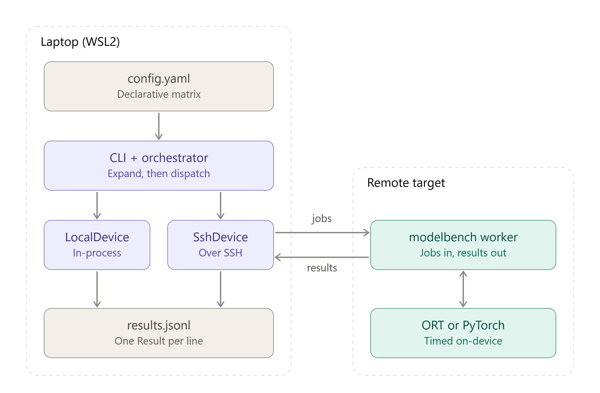

# modelbench

[](https://github.com/ditek/modelbench/actions/workflows/commit-check.yaml)

A small, config-driven harness for benchmarking ML inference across runtimes and devices. It runs the same model on ONNX Runtime and PyTorch, on the local machine and on remote Linux targets over SSH, and reports latency percentiles together with the device context needed to interpret them. The harness is not tied to any CPU architecture. During development it was tested on x86-64 and on an Arm Ampere A1.

**Status:** work in progress. See [Limitations](#limitations-and-next-steps).

## How it works



- `config.yaml` declares a matrix: model x runtime x device x precision x threads. The orchestrator expands it into jobs, each with a stable ID derived from its fields.
- Devices are adapters with one interface. `LocalDevice` runs jobs in-process. `SshDevice` sends all of a device's jobs to `modelbench worker` on the target as JSON lines and reads one result per line back.
- Failures are data, not crashes. A job the device cannot run (for example, more threads than CPUs) is recorded as `skipped` with a reason. An exception, a timeout or a dead host becomes a `failed` result, and the rest of the batch still runs.
- Every result carries device metadata: CPU model, architecture, kernel, Python version and runtime versions.

## Quick start

```bash
uv sync --extra bench
uv run --extra bench scripts/export_model.py        # exports MobileNetV2 to models/
uv run modelbench run examples/real.yaml --dry-run  # show the expanded job list
uv run --extra bench modelbench run examples/real.yaml --out results.jsonl
```

Checks: `uv run ruff check && uv run ruff format --check && uv run pytest` (also run by CI on every push).

### Adding a remote device

1. Set up key-based SSH to the target, clone this repo there, and install [uv](https://docs.astral.sh/uv/).
2. On the target: `uv sync --locked --extra bench`, then run the model export script.
3. Copy the template and edit it (`*.local.yaml` files are git-ignored):

   ```bash
   cp examples/two-devices.example.yaml examples/two-devices.local.yaml
   uv run --extra bench modelbench run examples/two-devices.local.yaml --out results.jsonl
   ```

   The template looks like this:

```yaml
models: [mobilenet_v2]
runtimes: [ort, torch]
devices:
  - {name: local, kind: local}
  - name: a1
    kind: ssh
    host: a1-board                          # anything `ssh` accepts
    remote_dir: /home/user/modelbench
    uv_path: /home/user/.local/bin/uv
precisions: [fp32]
threads: [1, 2]
```

Replace the host and `user` in the template with the actual values. Use absolute paths for `remote_dir` and `uv_path`.

## Sample results

These runs used two targets: the local x86-64 laptop and an Arm VM reached over SSH. MobileNetV2, fp32, batch size 1, 10 warm-up and 100 timed iterations per job. The table shows the p50 latency in ms as min-max over 3 repeated runs of the same config.

| Device | Runtime | Threads | p50 (ms) |
|---|---|---|---|
| x86-64 laptop (i7-1185G7, WSL2) | ORT | 1 | 9.8 - 12.8 |
| x86-64 laptop | ORT | 2 | 7.9 - 10.0 |
| x86-64 laptop | PyTorch | 1 | 24.9 - 28.5 |
| x86-64 laptop | PyTorch | 2 | 25.5 - 30.8 |
| Ampere A1 (Neoverse N1, 1 vCPU) | ORT | 1 | 27.4 - 28.2 |
| Ampere A1 | PyTorch | 1 | 44.5 - 45.3 |

On the A1, the 2-thread jobs are skipped because the VM has a single vCPU.

Observations from these runs (causes not yet investigated):

- Run-to-run spread is much larger on the laptop (about 30% for ORT at 1 thread) than on the A1 (about 3%).
- ORT was faster than PyTorch on both machines in every run. The PyTorch/ORT p50 ratio at 1 thread was 2.2-2.8x on the laptop and about 1.6x on the A1.

## Limitations and next steps

Known limitations:

- Targets must be Linux (the CPU metadata and core-count checks use Linux interfaces). Only x86-64 and aarch64 have been tested.
- fp32 only, and no accuracy check against a reference yet.
- All jobs of a batch run in one process, so jobs can interfere with each other. One process per job is the planned fix.

Planned: results storage in InfluxDB with a Grafana dashboard, a regression gate in CI, and an adb adapter for Android.